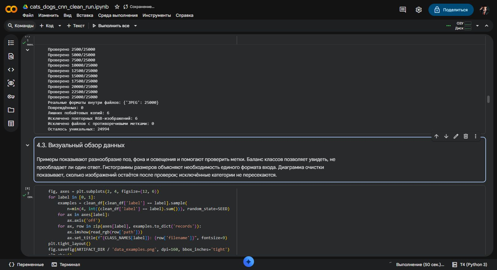
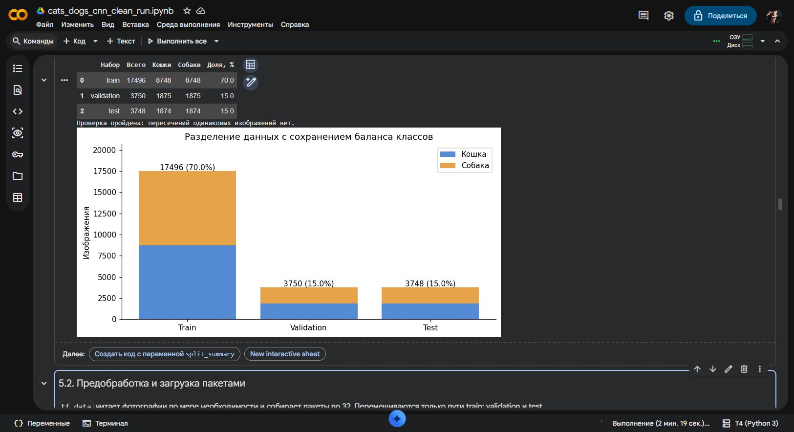
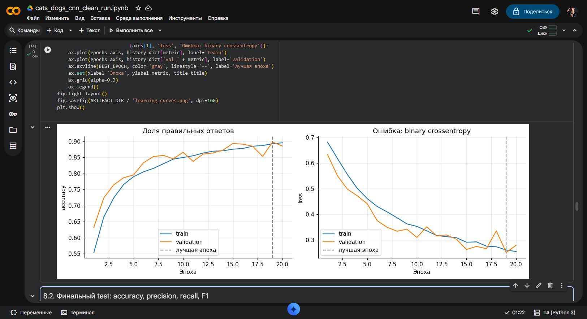
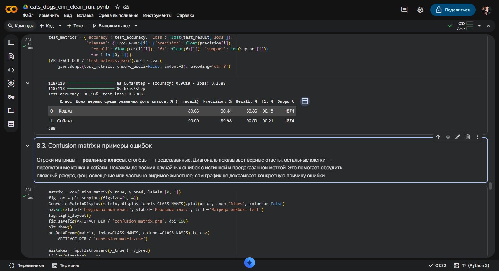
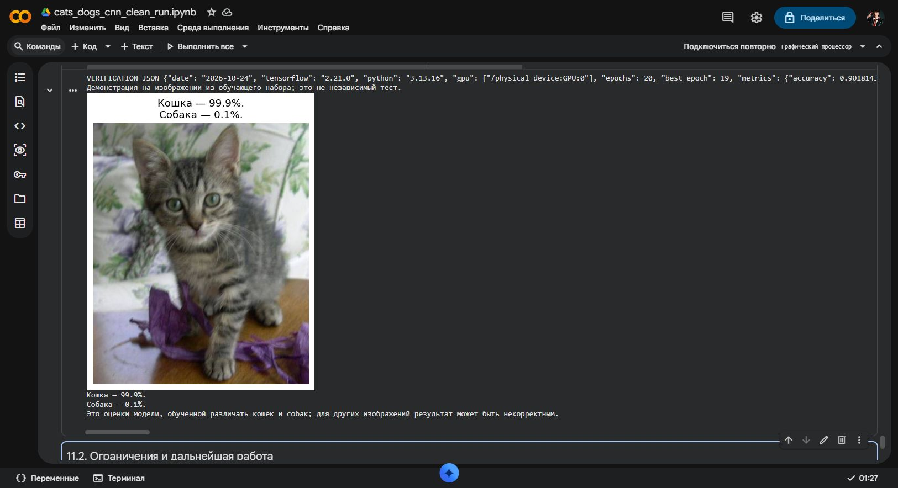

# Cats vs. Dogs — CNN from Scratch

[](https://colab.research.google.com/github/selecteg12/cats-dogs-cnn-from-scratch/blob/main/notebooks/cats_dogs_cnn.ipynb)

A complete educational image classification project built with TensorFlow/Keras.
A custom CNN learns from random initialization: **no pretrained backbone, transfer
learning, or external pretrained weights**. The notebook covers data auditing,
training, evaluation, visualizations, and a photo upload demo in Google Colab.
A separate command-line tool produces batch predictions as an `id,label` CSV.

[Notebook](notebooks/cats_dogs_cnn.ipynb) · [Data audit](docs/data_audit.json) · [Model card](docs/model_card.md)

## Verified results

A fresh Google Colab run on **24 October 2026** trained for 20 epochs on an
NVIDIA T4 using TensorFlow 2.21.0 and Python 3.13.16. The checkpoint from **epoch
19** was selected by validation loss (0.2507; validation accuracy 89.76%).

On the held-out test split, **3,380 / 3,748 predictions were correct: 90.18%
accuracy**, with binary cross-entropy loss **0.2388** and 368 errors.

- **Cat:** precision 90.44%, recall 89.86%, F1 90.15% (1,874 images).
- **Dog:** precision 89.93%, recall 90.50%, F1 90.21% (1,874 images).
- Confusion matrix, rows = true labels and columns = predictions, cat first:
  `[[1684, 190], [178, 1696]]`.

The [verification record](docs/verification_run.json) contains unrounded metrics
and all 20 epochs of training history. These results describe this dataset and
split, not arbitrary photos. A seed helps repeatability but GPU/runtime changes
can still produce different training results. Trained weights are stored in the
author's Google Drive and are not bundled in this repository.

## Screenshots from the Colab run

**Data audit.** Corrupt files and exact RGB duplicates are checked before splitting.



**Dataset split.** Each subset is balanced, and exact-image hashes are disjoint.



**Training history.** Accuracy and loss are plotted for train and validation;
the dashed line marks the selected checkpoint.



**Held-out evaluation.** The test set is evaluated after checkpoint selection.



**Single-image inference.** This example uses a training image to demonstrate
the inference function; it is not additional evidence of test accuracy.
Scores are model estimates, not calibrated confidence guarantees.



## Training data

The training archive was provided locally by the author. It contains **25,000 JPEG
images: 12,500 cats and 12,500 dogs**. Labels are derived from file names such as
`cat.327.jpg` and `dog.438.jpg`; all usable files have a `.jpg` extension and decode
as JPEG. Files in `__MACOSX` are resource-fork metadata and are ignored.

- Archive: `train.zip`, **580,176,617 bytes** (approximately 553.3 MiB).
- SHA-256: `5f9304854c39a71b7954891159e4f99c76fbe4369736a1164534b1566d1e25f0`.
- Original data audit: **0 corrupt images**, **6 extra exact copies**, and
  **0 conflicting labels** for identical RGB images.
- After cleaning: **24,994 images**, or 12,497 per class.

The original download URL and redistribution license were not recorded. File
names and class counts alone do not establish provenance. **This repository does
not redistribute the images or archive.** Use the checksum above to identify the
exact archive used in the experiment. Another appropriately licensed dataset can
be supplied using the same naming convention; report its results separately.

Each class is shuffled with seed 42 and split approximately 70/15/15:

- **Train:** 17,496 images — 8,748 cats and 8,748 dogs.
- **Validation:** 3,750 images — 1,875 cats and 1,875 dogs.
- **Test:** 3,748 images — 1,874 cats and 1,874 dogs.

Exact duplicate detection hashes dimensions and original EXIF-corrected RGB
pixels **before resizing**. Duplicate groups with conflicting labels are excluded.
RGB hashes must not overlap across splits. This does not detect near-duplicates,
recompressed JPEGs, or different photos of the same animal.

## Model

```text
RGB 128×128×3, float32 values in [0, 255]
 → Rescaling(1/255)
 → training-only horizontal flip, rotation and zoom
 → Conv2D(32, 3×3, ReLU, same)  → MaxPooling2D
 → Conv2D(64, 3×3, ReLU, same)  → MaxPooling2D
 → Conv2D(128, 3×3, ReLU, same) → MaxPooling2D
 → Conv2D(128, 3×3, ReLU, same) → MaxPooling2D
 → Dropout(0.25) → Flatten → Dense(64, ReLU)
 → Dropout(0.5) → Dense(1, sigmoid)
```

**765,249 trainable parameters.** Training uses Adam (`learning_rate=0.001`), binary
cross-entropy, batches of 32, at most 20 epochs, and early stopping after four
epochs without a validation-loss improvement. The best validation-loss checkpoint
is used for final test evaluation. Test data is never passed to `fit`.

Pillow applies EXIF orientation, RGB conversion, and bilinear resizing. Resizing
stretches the aspect ratio. **Normalization is inside the model:** inference must
receive pixels in [0, 255], not pixels divided by 255 again.
The single sigmoid output is `p_dog`: `p_dog > 0.5` means **dog = 1**, otherwise
**cat = 0**. Augmentation and Dropout are disabled during inference.

## Run in Google Colab

1. Open [Google Colab](https://colab.research.google.com/), choose **File → Open
   notebook → GitHub**, paste this repository's URL, and select
   `notebooks/cats_dogs_cnn.ipynb`.
2. Select a GPU runtime.
3. Place your archive at `My Drive/cats_dogs_cnn/data/train.zip`, or change
   `DRIVE_ZIP_PATH` in section **2.1**.
4. Run all cells and authorize Drive when prompted. Alternatively, set
   `DATA_SOURCE = 'upload'` in section **3.1** and upload one ZIP.
5. Use the JPG/PNG upload button in section **9.2** for a demonstration.

Notebook explanations are in Russian; this README describes the workflow in English.

### Saved checkpoints

The default model path is `My Drive/cats_dogs_cnn/runs/default/best_model.keras`.
The same folder stores `history.json`, `run_config.json`, and evaluation artifacts.
A full rerun reuses a checkpoint only when the archive checksum, seed, architecture,
TensorFlow version, and settings match. Set `FORCE_RETRAIN = True` in section 2.1
for a fresh training run. Use separate `SAVED_RUN_DIR` directories for concurrent
experiments.

After restarting Colab, the standalone cell in section **9.2** reloads the saved
model and upload button without training. Update its model directory if you used
a custom path. Drive authorization may be required again.

## Batch inference

For local inference, use Python 3.11 or 3.12 and a virtual environment. Download
**your own trained** `best_model.keras` into `models/`, then run:

```bash
python -m pip install -e .
cats-dogs-predict --model models/best_model.keras --input data/test.zip --output outputs/predictions.csv
```

`--input` accepts a ZIP or directory, including nested directories. Supported
formats are JPG/JPEG/PNG. IDs are complete file names without extensions:
`123.jpg` becomes `123`, while `dog.123.jpg` becomes `dog.123`. IDs must be unique.
Numeric IDs are sorted numerically. Change the default batch size with `--batch-size`.

The output contains exactly two columns with no extra row index:

```csv
id,label
1,0
2,1
```

These rows illustrate the format; they are not experimental predictions.
Invalid images stop inference with the affected ID instead of silently dropping
rows. The output CSV is written after inference completes and replaces an existing
file of the same name.

To download a publicly accessible ZIP from Google Drive:

```bash
python -m pip install -e ".[download]"
cats-dogs-predict --model models/best_model.keras --drive-file-id YOUR_FILE_ID --output outputs/predictions.csv
```

`YOUR_FILE_ID` is the part between `/d/` and `/view` in the sharing URL. Downloads
use [gdown](https://github.com/wkentaro/gdown); this does not authorize access to a
private Drive account.

## Repository layout

```text
notebooks/cats_dogs_cnn.ipynb  Training, evaluation and Colab photo demo
src/cats_dogs_cnn/            Preprocessing and batch inference CLI
tests/                       Data, inference and notebook checks
docs/data_audit.json          Checked archive and split statistics
docs/model_card.md           Intended use and limitations
docs/screenshots/            Verification-run screenshots
data/                        Your datasets; contents ignored by Git
models/                      Your trained weights; contents ignored by Git
outputs/                     Your predictions; contents ignored by Git
```

## Tests

```bash
python -m pip install -e . pandas
python -m unittest discover -s tests -v
```

Tests cover preprocessing parity across training, standalone demo and CLI; the
class threshold; CSV IDs and columns; duplicate handling; repeatable disjoint
splits; ZIP path validation; cache invalidation; and notebook syntax. With
TensorFlow installed, a smoke test checks the actual CNN's parameter count,
input/output contract, and forward pass. GitHub Actions runs the tests.
Dependency ranges are not a frozen environment lockfile.

## Limitations

This is an educational two-class classifier. It will assign a cat/dog score to
unrelated objects. Scores have not been calibrated as probabilities. Low input
resolution, aspect-ratio distortion, background correlations and near-duplicates
may affect evaluation. Test-split performance does not establish performance on
arbitrary photos from another source.

Possible improvements include aspect-ratio-preserving resizing, near-duplicate
grouping, label review and validation-guided regularization changes. An independent
external test set is needed to evaluate improvements after examining this test set.
